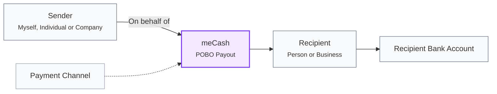

The **Pay on Behalf Of (POBO)** flow allows you to initiate cross-border payouts where the funds are sent by your business itself, or on behalf of an individual or another registered company (the sender), to the final destination (the recipient).

In standard local payouts, your platform's workspace or wallet owner is implicitly assumed to be the sender. However, for international transfers, global compliance and Anti-Money Laundering (AML) regulations require strict identification of both the sending and receiving parties.



The flow represents the relationship between the parties:

* **Sender:** The business itself, or the individual or company on whose behalf the payout is being made.
* **meCash POBO Payout:** Processes the payout using the specified quote and payment channel.
* **Recipient:** The final beneficiary receiving the funds.
* **Recipient Bank Account:** The account where the funds are delivered.
* **Payment Channel:** Determines how the payout is routed and how SWIFT transfer charges are handled.

## Supported Corridors

POBO requires a `sender` object and is currently supported for:

* **US Dollar (USD):** To US bank accounts via SWIFT.

<Note>
  EUR payouts sent through the `SWIFT` payment channel no longer use the POBO flow. Send them as standard payouts. See the [EUR payout example](/payout-docs/payout-examples/eur-payout).
</Note>

---

## Sender Types

The POBO flow supports three types of sender. Choose the one that matches who the funds are being sent for. The only difference between them in the request is the `sender` object.

| Type | Who is sending | `sender.type` |
| :--- | :------------- | :------------ |
| **1. Business (Myself)** | Your business, sending as itself. | Not set |
| **2. Individual** | A person, on whose behalf your business is sending. | `PERSON` |
| **3. Company** | Another registered company, on whose behalf your business is sending. This is not your own business. | `BUSINESS` |

### Type 1: Business (Myself)

Use this when your business is the sender. Leave out `sender.type` and `sender.name`, and the payout is sent in your business's own name. Provide the business's KYC details:

* `icNumber`: Identification number.
* `mobileNumber`: International mobile number (e.g., `+234...`).
* `nationality`, `address`, `occupation` and `dateOfBirth`.

### Type 2: Individual

Use this when you are sending on behalf of a person. Set `sender.type` to `PERSON` and provide the person's details, including:

* `name`, `idNumber`, `dateOfBirth`, `gender` and `nationality`.
* `relationship`: The person's relationship to your business (e.g., `Parents`, `Friend`).
* `address`, `mobileNumber` and `occupation`.

### Type 3: Company

Use this when you are sending on behalf of another registered company. Set `sender.type` to `BUSINESS` and provide the company's details, including:

* `name`: The company's registered name.
* `registrationNumber` and `dateOfIncorporation`.
* `relationship`: The company's relationship to your business (e.g., `Business Partner`).
* `nationality`, `address` and `occupation`.

---

## The Recipient Object

The `recipient` object must capture the final beneficiary receiving the funds.

Set `recipient.type` to `INDIVIDUAL` (or `PERSON`) or `BUSINESS`. You must also provide international banking credentials:

* `swiftCode`: The BIC/SWIFT code.
* `accountNumber` or `iban`: The recipient's local account number or IBAN.

---

## Payment Channels & Fees

For POBO payouts, the `paymentChannel` must be provided at the **root level** of the JSON request. Use it to specify who bears the SWIFT transfer charges:

| Channel             | Charge Bearer | Description                                                                                        |
| :------------------ | :------------ | :------------------------------------------------------------------------------------------------- |
| `SWIFT_OUR`         | Sender        | The sender bears all transfer charges. Your platform absorbs the full cost of the transfer.        |
| `SWIFT_SHARED`      | Both parties  | Charges are shared. The beneficiary receives a net amount after their portion of fees is deducted. |
| `SWIFT_BENEFICIARY` | Beneficiary   | The beneficiary bears all transfer charges.                                                        |

---

## Constructing the Request

To initiate a POBO payout, link an active Quote to the transaction and pass both the `sender` and `recipient` objects.

### Example: USD POBO (SWIFT)

<Tabs>
  <Tab title="Type 1: Business (Myself)">
```json
{
  "quoteId": "12f4e439-e000-436b-9706-98c4fc2b0486",
  "reason": "BUSINESS_INVOICE",
  "paymentChannel": "SWIFT_OUR",
  "currency": "USD",
  "sender": {
    "icNumber": "12344",
    "nationality": "NG",
    "address": {
      "line1": "12 Main Street"
    },
    "mobileNumber": "+2348099370922",
    "occupation": "C-Suite executive / Board member",
    "dateOfBirth": "1999-12-12"
  },
  "recipient": {
    "name": "Jane Smith",
    "type": "PERSON",
    "account": {
      "bankName": "Chase Bank",
      "accountNumber": "857362910",
      "swiftCode": "CHASUS33XXX"
    }
  }
}
```
  </Tab>
  <Tab title="Type 2: Individual">
```json
{
  "quoteId": "12f4e439-e000-436b-9706-98c4fc2b0486",
  "reason": "FAMILY_SUPPORT",
  "paymentChannel": "SWIFT_OUR",
  "currency": "USD",
  "sender": {
    "type": "PERSON",
    "name": "Jane James",
    "idNumber": "A123456",
    "dateOfBirth": "2000-12-12",
    "relationship": "Friend",
    "gender": "F",
    "nationality": "NG",
    "address": {
      "line1": "12 Main Street"
    },
    "mobileNumber": "+2348099377377",
    "occupation": "Employee"
  },
  "recipient": {
    "name": "Jane Smith",
    "type": "PERSON",
    "account": {
      "bankName": "Chase Bank",
      "accountNumber": "857362910",
      "swiftCode": "CHASUS33XXX"
    }
  }
}
```
  </Tab>
  <Tab title="Type 3: Company">
```json
{
  "quoteId": "12f4e439-e000-436b-9706-98c4fc2b0486",
  "reason": "BUSINESS_INVOICE",
  "paymentChannel": "SWIFT_OUR",
  "currency": "USD",
  "sender": {
    "type": "BUSINESS",
    "name": "ABC Limited",
    "registrationNumber": "123456",
    "dateOfIncorporation": "2016-07-02",
    "relationship": "Business Partner",
    "nationality": "NG",
    "address": {
      "line1": "12 Main Street"
    },
    "occupation": "C-Suite executive / Board member"
  },
  "recipient": {
    "name": "Jane Smith",
    "type": "PERSON",
    "account": {
      "bankName": "Chase Bank",
      "accountNumber": "857362910",
      "swiftCode": "CHASUS33XXX"
    }
  }
}
```
  </Tab>
</Tabs>

---

## Webhooks & Tracking

POBO payouts settle asynchronously over international networks (like SWIFT), which means they rarely succeed instantly.

1. **Initial Status:** A successful API response will return a `state` of `PENDING`.
2. **Tracking via API:** Use the [Get Transaction API](/transaction-docs/get-transaction) using the `referenceNumber` to poll the status.
3. **Webhooks:** The most reliable way to track completion is to subscribe to the [`payout.completed`](/webhook/payout-webhook) and [`payout.failed`](/webhook/payout-webhook) webhook events.

## Error Handling

If you misconfigure the POBO fields, you will likely encounter a `400 Bad Request` or `422 Unprocessable Entity`. Common validation errors include:

* Missing `sender` object for USD requests.
* Invalid `sender.type` (must be `PERSON` or `BUSINESS`, or left out for Business (Myself)).
* Missing `paymentChannel` at the root of the request payload.
* Using a non-SWIFT `paymentChannel` for a POBO payout.