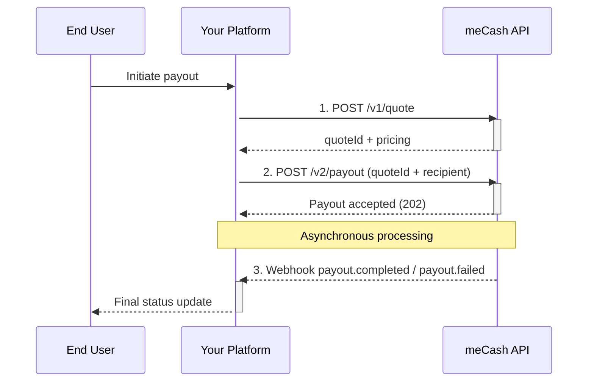

The **meCash Payout API** lets you send funds to recipients across multiple corridors. Every payout must reference a valid `quoteId`, ensuring the exchange rate, fees, and limits applied during quoting remain intact at execution time.

## Payout lifecycle

<Tip> Subscribe to payout webhooks to receive reliable delivery and failure notifications. See [Payout Webhook Events](/webhook/payout-webhook) and [Signature Verification](/webhook/webhooks-signature-verification) for implementation details.</Tip>

## Operational considerations

- **Quotes are mandatory**: Always [create a quote](/quote-docs/create-quote) first and reuse the `quoteId` during payout creation.
- **Idempotency**: Use client-generated references to safely retry payouts without double-paying.
- **Webhooks**: Treat the synchronous payout response as an acknowledgement. The final status arrives via [payout webhook](/webhook/payout-webhook).
- **Compliance rules**: Review the `rules` array on the quote to enforce per-corridor limits in your UI.

## Payout API Routes

<CardGroup cols={3}>
  <Card title="🇳🇬 NGN Payout" href="/payout-docs/payout-examples/ngn-payout">
    Local-to-local naira payout with BVN checks and instant settlement.
  </Card>
  <Card title="🇺🇸 USD Payout" href="/payout-docs/payout-examples/usd-payout">
    Send US Dollars to a US bank account globally.
  </Card> 
  <Card title="🇪🇺 EUR Payout" href="/payout-docs/payout-examples/eur-payout">
    Move Euros to a EUR bank account globally.
  </Card>
  <Card title="🇬🇧 GBP Payout" href="/payout-docs/payout-examples/gbp-payout">
    Send Great British Pounds to a UK bank account globally.  
  </Card>
  <Card title="🇨🇦 CAD Payout" href="/payout-docs/payout-examples/cad-payout">
    Send Canadian Dollar to a Canadian bank account globally.
  </Card>
  <Card title="🇲🇼 MWK Payout" href="/payout-docs/payout-examples/mwk-payout">
    Send Malawian Kwacha to a Malawian bank account.
  </Card>
  <Card title="🇷🇼 RWF Payout" href="/payout-docs/payout-examples/rwf-payout">
    Send Rwandan Franc to a Rwandan bank account globally. 
  </Card>
  <Card title=" 🇨🇳 CNY Payout" href="/payout-docs/payout-examples/cny-payout">
    Send Chinese Yuan to a Chinese bank account globally.  
  </Card>
  <Card title=" 🇻🇳 VND Payout" href="/payout-docs/payout-examples/vnd-payout">
    Send Vietnamese Dong to a Vietnamese bank account globally.  
  </Card>

</CardGroup>

## Next steps

- Create a payout with [`POST /v2/payout`](/payout-docs/create-payout).
- **Send to multiple recipients at once** with the [`Bulk Payout API`](/payout-docs/bulk-payout) — ideal for payroll, vendor payments, and mass disbursements.
- Get bank list
- Explore corridor-specific payloads with the example cards above or jump straight to the [`payout docs examples`](/payout-docs/payout-examples).
- Monitor disbursement states using the [`Get Transaction API`](/transaction-docs/get-transaction). 
